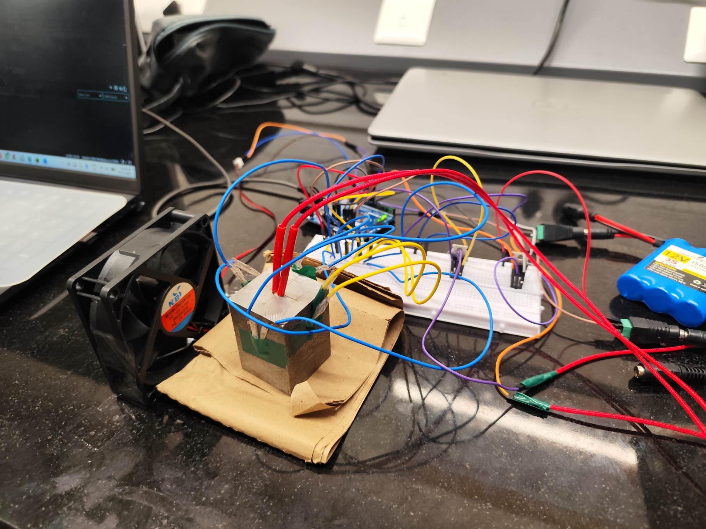
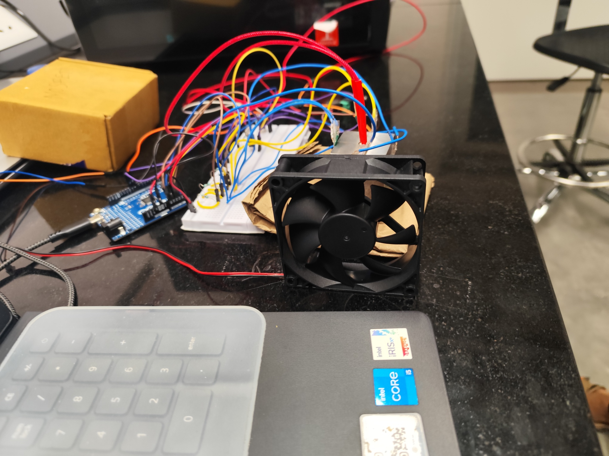
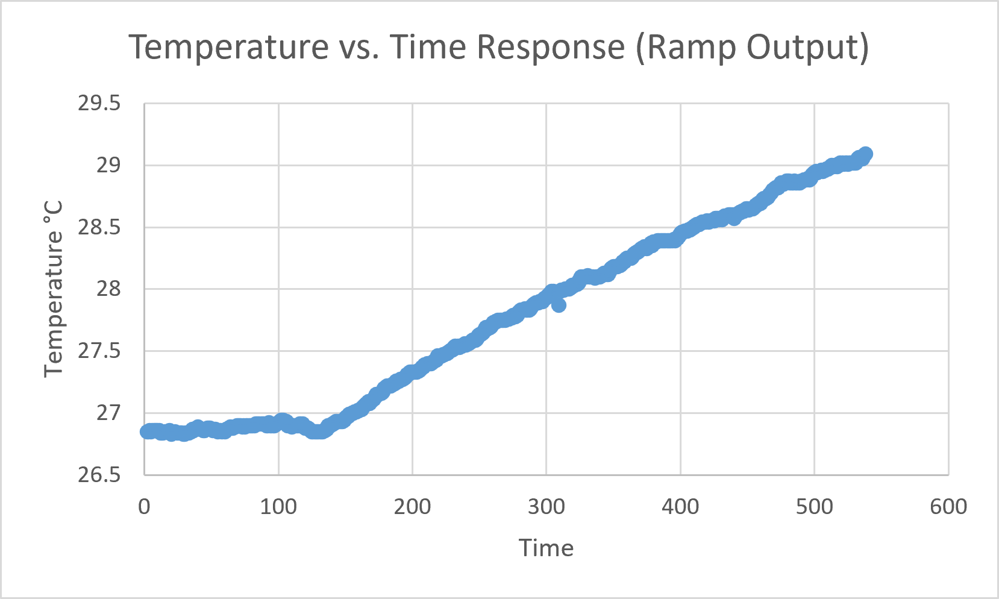

Thermal PID Temperature Control (Arduino)
Arduino-based temperature control of a heater block. A heating element warms the block, a PC/laptop-style cooling fan removes heat, and thermistors act as the temperature sensors. The controller is a PID tuned with the Cohen-Coon method, using a step test on the real system.
This is a Process Control Lab (PCL) project.
Project overview
The goal was to control the temperature of a heater block using a fan. The work was done in stages:
1. Ramp response of the heater block: observe the open-loop thermal dynamics.
2. ON-OFF fan control: baseline feedback control with hysteresis.
3. Steady-state determination: find the heater and fan inputs at which the block settles.
4. Step test: from that initial steady state, apply a step input and let the block settle at a new final steady state.
5. Cohen-Coon tuning: use the step response to calculate the PID parameters.
6. PID control: setpoint tracking and disturbance rejection (the sketches in this repo).
Hardware setup
An aluminium block is heated by a cartridge heater and cooled by a fan of the kind used in laptops and PCs. Four thermistors read the temperature of four sides of the block, and an Arduino runs the control loop.
Front view: the cooling fan faces the heater block; the breadboard and Arduino are behind it.

Overview: heater block with cartridge heater leads, breadboard wiring, the MOSFET switch, the fan, and data logging on the laptop.

Tuning method: step test and Cohen-Coon
1. Find the steady state: the heater and fan inputs at which the block stops changing in temperature (heater 10%, fan 15%).
2. From that initial steady state, apply a step input.
3. Let the block settle at the new, final steady state and record the whole response.
4. Use the initial and final steady states and the shape of the response to get the process gain, time delay and time constant.
5. Calculate Kc, Ti and Td with the Cohen-Coon tuning method and load them into the sketches.
Repository structure
thermal-pid-control/
├── README.md
├── images/
├── PID_cohen/
│   └── PID_cohen.ino
└── SetPointTracking/
    └── SetPointTracking.ino
Process background
The heater block is modelled as a first-order thermal system. An energy balance gives:
Q(t) = m*cp*dT/dt + h*A*(T - Ta)
Symbol
Meaning
Q
heat supplied by the heater
m
mass of the block
cp
specific heat capacity
T, Ta
block and ambient temperature
h
convective heat transfer coefficient
A
exposed surface area
In deviation variables the transfer function is G(s) = K / (tau*s + 1), with gain K = 1/(hA) and time constant tau = m*cp/(hA).
ON-OFF control (baseline)
The fan switches ON at 29 C or above and OFF below 27 C, giving a 2 C hysteresis band that prevents rapid switching.
Steady-state operating point
Steady state (dT/dt close to 0) was found at:
• Heater input: 10%
• Fan input: 15%
• Tolerance: +/- 0.02 C
The sketches start from this point.
Sketches
Sketch
Purpose
PID_cohen/PID_cohen.ino
Disturbance rejection: holds 26.5 C while the heater is stepped from 10% to 50% between t = 180 s and t = 240 s.
SetPointTracking/SetPointTracking.ino
Setpoint tracking: heater fixed at 10%, setpoint steps from 26.5 C to 25.5 C at t = 120 s.
Circuit connections
Four thermistors read the temperature of four sides of the block. A MOSFET acts as a switch for the cartridge heater, and a cooling fan (of the kind used in laptops and PCs) removes heat.
Heater (MOSFET switch)
MOSFET terminal
Connected to
Gate
Arduino pin 9
Source
Arduino GND
Drain
Cartridge heater, lead 1
• A 10 kOhm resistor sits between Gate and Source (pull-down).
• Cartridge heater, lead 2, goes to the 12 V supply.
• The 12 V supply 0 V is tied to Arduino GND.
Thermistor (voltage divider)
• Thermistor lead 1 goes to 5 V.
• Thermistor lead 2 goes to analog pin A0.
• A fixed resistor goes from A0 to GND.
• The other three thermistors are wired the same way on A1, A2 and A3.
Fan
The fan is driven from Arduino pin 10, set by fanPin in both sketches. Pin 10 is a hardware PWM pin on the Uno and Nano, so the fan speed can be controlled proportionally from 0 to 100%.
Hardware
• Arduino Uno / Nano
• 4 thermistors on A0 to A3 (voltage dividers)
• Heater driven by PWM on pin 9
• Cooling fan driven by PWM on pin 10
• Serial connection at 9600 baud for logging
Note: On Uno/Nano the hardware PWM pins are 3, 5, 6, 9, 10 and 11. Pin 8 is not a PWM pin, so analogWrite(8, ...) only gives fully on/off output. Move the fan to a PWM pin (for example 10) and update fanPin for proportional control.
Calibration
Each thermistor uses a two-point linear fit from ADC readings at 26 C and 31 C (ADC_26[], ADC_31[]). Re-measure these for your own sensors.
Controller
Cohen-Coon parameters (ideal PID form; Kc is negative because the fan is a cooling action):
Parameter
Value
Kc
-3005.19
Ti
2.440729
Td
0.362319
• 1 s sample time; each thermistor averaged over 10 ADC reads
• Derivative on measurement (avoids derivative kick on setpoint changes)
• Conditional-integration anti-windup
• Fan output clamped to 0-100% and mapped to 0-255 PWM
Usage
1. Open a sketch in the Arduino IDE (the .ino file must sit in a folder of the same name).
2. Select your board and port, then upload.
3. Open the Serial Monitor at 9600 baud.
4. Log columns: time, T1 to T4, average, setpoint, fan %, heater % (plus status for PID_cohen).
PID_cohen prints tab-separated values and SetPointTracking prints CSV; both paste easily into Excel or Python for plotting.
Results
Add your graphs here, for example from an images/ folder:

